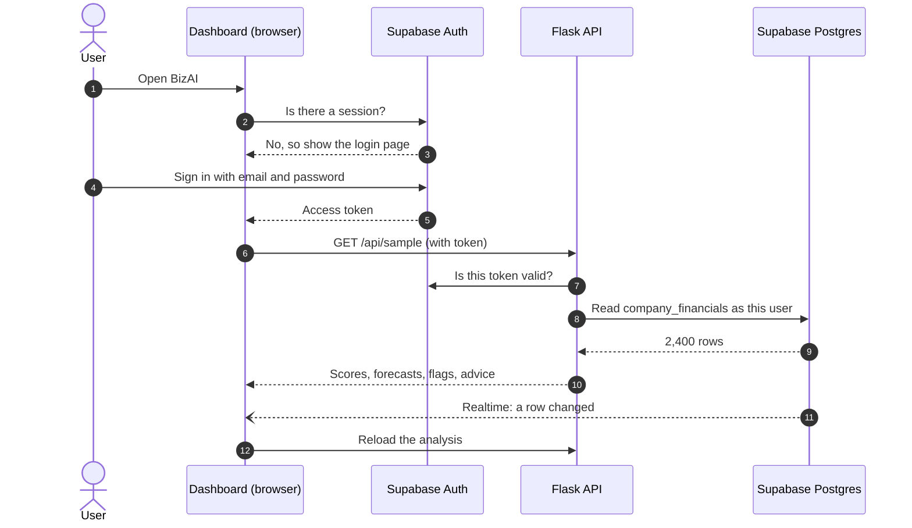
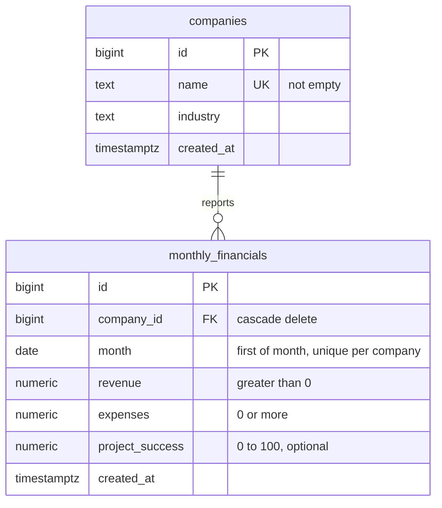

<p align="center">
  
</p>

<p align="center">
  
</p>

<p align="center">
  
  
  
  
  
  
</p>

<p align="center">
  <a href="#features"><b>Features</b></a> &nbsp;·&nbsp;
  <a href="#getting-started"><b>Getting started</b></a> &nbsp;·&nbsp;
  <a href="#database"><b>Database</b></a> &nbsp;·&nbsp;
  <a href="#sign-in"><b>Sign-in</b></a> &nbsp;·&nbsp;
  <a href="#deployment"><b>Deployment</b></a> &nbsp;·&nbsp;
  <a href="#methodology"><b>Methodology</b></a> &nbsp;·&nbsp;
  <a href="#results"><b>Results</b></a>
</p>

---

**BizAI** turns monthly revenue and expense data into a clear, honest picture of each company's financial health.
It scores every company, forecasts the next quarter and *proves* how accurate that forecast is, flags the months
that broke the pattern, and explains what management could do about it. Data streams live from a Supabase
database behind a secure sign-in.

<p align="center"><b>Author:</b> Dhanushree B.M</p>

<p align="center">
  
</p>

## Features

<table>
<tr>
<td width="50%" valign="top">

### Overview
A one-line headline for each company, a health score from 0 to 100, key figures with trend lines, and a
revenue chart with a three-month forecast and its 80% range.

</td>
<td width="50%" valign="top">

### Risks
Months whose profit margin broke from the normal pattern, with the cause (revenue or expenses) and
recommended next steps. Select a month to jump to it on the chart.

</td>
</tr>
<tr>
<td valign="top">

### What-if
Cut expenses or change revenue growth with sliders and see the effect on next quarter's profit and margin,
with a breakdown of how the health score is built.

</td>
<td valign="top">

### Ask BizAI
Questions in plain English: *"Which company has the best margin?"*, *"Compare Sahyadri and Konkan"*,
*"Revenue in March 2024"*, *"What if we cut costs by 10%?"*

</td>
</tr>
<tr>
<td valign="top">

### All companies
A league table ranking every company by health, and upload of your own CSV or Excel file.

</td>
<td valign="top">

### Live and secure
Email sign-in through Supabase Auth. The dashboard redraws itself when the database changes.
Light and dark themes, and a print-ready report.

</td>
</tr>
</table>

## How it works

<p align="center">
  
</p>



## Getting started

```bash
git clone https://github.com/Dhanushree-BM13/BizAI.git
cd BizAI
pip install -r requirements.txt
python app.py
```

Open **<http://127.0.0.1:5000>**, create an account on the login page and sign in. The bar at the top of the
dashboard shows a pulsing **Live** dot when it is reading from Supabase.

| Variable | Purpose | Default |
|---|---|---|
| `SUPABASE_URL` | Supabase project URL | The project's Supabase instance |
| `SUPABASE_KEY` | Supabase **publishable** key | The project's publishable key |

> [!IMPORTANT]
> Only the publishable key is used. It is designed to be public: the database's security rules let it do
> nothing on its own. The secret key and the database password are never needed by the app and must never be
> committed to this repository.

## Database

Run two scripts once, in order, in the Supabase **SQL Editor**. Both are safe to run again.

| Step | Script | What it does |
|:---:|---|---|
| 1 | [`supabase/schema.sql`](supabase/schema.sql) | Tables, constraints, view, security rules and realtime |
| 2 | [`supabase/seed.sql`](supabase/seed.sql) | 40 demo companies × 60 months, computed inside Postgres from each company's parameters |



- **Normalised:** each company's name and industry are stored once, not on every month.
- **Constraints** reject bad data at the source: empty names, mid-month dates, zero revenue, negative expenses,
  success rates outside 0–100, duplicate company months.
- **`company_financials`** is a view joining both tables into the flat shape the app reads.
- **Row level security:** only signed-in users can read; nobody can write through the API.
- **Realtime** is on for both tables.

## Sign-in

Accounts are handled entirely by **Supabase Auth**; the app never sees a password.

- The login page offers **sign in**, **create account**, **forgot password** and **choose a new password**.
- The dashboard sends visitors without a session to the login page, and offers **Sign out**.
- The server checks the user's access token on every data request and reads the database *as that user*,
  so the database's own security rules apply.

<details>
<summary><b>Supabase Auth settings</b></summary>
<br>

In **Authentication → URL Configuration**:

- **Site URL:** the deployed address, for example `https://bizai.vercel.app`
- **Redirect URLs:** add `http://localhost:5000/login.html` and `https://<your-domain>/login.html`

These make the confirmation and password-reset emails link back to the app. Email confirmation is on by default;
new users confirm their address before their first sign-in.

</details>

## Deployment

<p>
  <a href="https://vercel.com/new/clone?repository-url=https://github.com/Dhanushree-BM13/BizAI">
    
  </a>
</p>

1. Import the repository at [vercel.com/new](https://vercel.com/new), keep the defaults and click **Deploy**.
2. Vercel detects the Flask `app` in `app.py`, installs `requirements.txt` on Python 3.12 and serves `public/`
   from its CDN.
3. Add the deployed address to the Supabase Auth settings above.

Every push to `main` redeploys. `vercel.json` allows 60 seconds per request, which covers the first request after
a cold start. Uploads are limited to 4 MB, below Vercel's 4.5 MB request limit.

## Methodology

<details>
<summary><b>Forecast</b>: linear regression with trend and seasonality</summary>
<br>

A scikit-learn `LinearRegression` is fitted to each company's revenue over time. With 24 or more months, sine and
cosine terms let it learn a yearly seasonal pattern. Two trend shapes are tried, a straight line and constant
percentage growth (a straight line on the log scale), and the better fit is kept. The shaded band is ±1.28 residual
standard deviations, an approximate 80% range.

</details>

<details>
<summary><b>Accuracy check</b>: back-testing against a naive baseline</summary>
<br>

The last three months are hidden, forecast from the earlier data and compared with what really happened. This is
repeated over four windows, covering the last twelve months. Accuracy is reported as MAPE (mean absolute percentage
error) against a naive baseline that predicts "the same as the last known month".

</details>

<details>
<summary><b>Unusual months</b>: two independent checks must agree</summary>
<br>

Each month's profit margin is compared with the trend of the company's own margin. A month is flagged only when its
deviation is beyond 1.8 standard deviations **and** an `IsolationForest` ranks it among the 30% most unusual months.
The report says whether revenue or expenses moved further from trend, which points to the likely cause.

</details>

<details>
<summary><b>Health score</b>: five weighted parts</summary>
<br>

| Part | Weight | Based on |
|---|:---:|---|
| Profitability | 30% | Profit margin, last three months |
| Growth | 25% | Monthly revenue trend |
| Delivery | 20% | Project success rate, last three months |
| Stability | 15% | Unusual low-margin months in the last year |
| Cost control | 10% | Expenses growing faster than revenue |

The weights are a design choice that puts profitability first, not values learned from data. Without a project
success column, Delivery is left out and the other weights are rescaled.

</details>

<details>
<summary><b>Ask BizAI</b>: rule-based, and honest about it</summary>
<br>

The answerer finds company names, a measure, a month and the type of question in the text, then builds the answer
from the analysis. It ranks, compares, explains scores and runs what-if scenarios. It is not a language model, and
it says so when a question falls outside what it can answer.

</details>

## Results

Back-testing on all 40 demo companies:

| | Model | Naive baseline |
|---|:---:|:---:|
| Median forecast error (MAPE) | **1.49%** | 5.51% |
| Companies where the model wins | **40 of 40** | — |
| Model error range | 0.51% – 2.97% | — |

## Project structure

```
BizAI/
├── app.py               Flask server, API and sign-in checks
├── analytics.py         Cleaning, forecasting, back-testing, anomaly detection, scoring
├── public/
│   ├── index.html       Dashboard and Ask BizAI
│   ├── login.html       Sign in, sign up and password reset
│   └── logo.svg         Logo and browser icon
├── supabase/
│   ├── schema.sql       Tables, view, security and realtime
│   └── seed.sql         Demo data (generated)
├── generate_data.py     Builds financial_data.csv and supabase/seed.sql
├── financial_data.csv   Demo data for local testing
├── sample_upload.csv    8 new companies for trying the upload
├── test_analytics.py    Automated tests
├── assets/              README graphics and logo
├── requirements.txt     Pinned dependencies
└── vercel.json          Vercel function settings
```

<details>
<summary><b>API reference</b></summary>
<br>

| Method | Path | Sign-in | Description |
|---|---|:---:|---|
| `GET` | `/api/sample` | ✓ | Full analysis of the live data; `X-Data-Source` header is `supabase` or `csv` |
| `POST` | `/api/analyze` | ✓ | Analysis of an uploaded file (field `file`, CSV or Excel, up to 4 MB) |
| `GET` | `/api/sample.csv` | | Download a sample file of 8 companies not in the database, for trying the upload |
| `GET` | `/api/config` | | Supabase details the pages need for sign-in and live updates |

Uploads need **Company**, **Date**, **Revenue** and **Expenses** columns; **Industry** and **Project_Success** are
optional. Each company needs at least six months of data.

</details>

## Testing

```bash
python test_analytics.py
```

Twelve tests cover forecasting, back-testing, anomaly detection, input validation, scoring without optional columns,
repeatable demo data, the seed script, the upload sample, every API endpoint, upload limits and the sign-in requirement.

## Limitations

- The 40 companies and their figures are **invented**. The demo data follows a trend and a yearly pattern, which
  suits the model; real company data will be less predictable.
- Forecasts are statistical projections, **not financial advice**.
- Uploaded files are analysed in memory and not stored.

---

<p align="center"><sub>Built by <b>Dhanushree B.M</b> · Flask · scikit-learn · Supabase · Vercel</sub></p>
